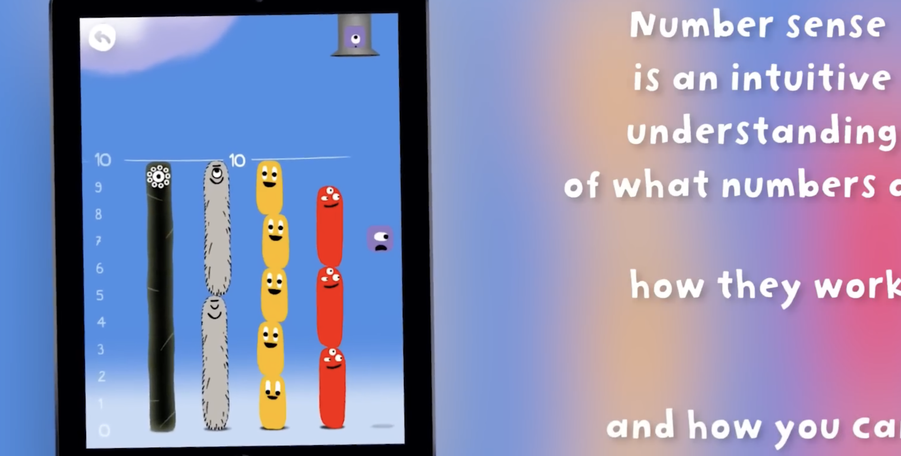
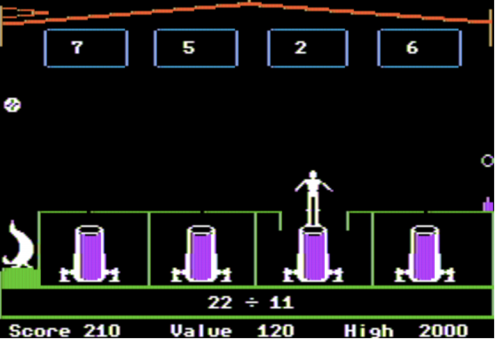

Math Kingdom — Defend the Realm with Mathematics

Tagline: Solve equations. Build defenses. Save the kingdom!

Game Concept

Math Kingdom is a 2D educational strategy game in which the player protects a fantasy castle from waves of monsters by solving mathematics problems. Correct answers earn energy and gold that can be spent on towers, repairs, and special abilities. The player must decide where to build defenses, which enemy to target, and when to spend limited resources. Across five regions, the mathematical challenges progress from arithmetic to fractions, equations, and logical reasoning.

Platform: Desktop web browser, controlled using a mouse and keyboard.

Concept screenshot: Add an original mockup showing the castle, a path with incoming monsters, defensive towers, a resource bar, and a mathematical question panel.

  

────────

Formal Elements

1. Players

Math Kingdom is designed primarily for students aged 10–16 who know basic arithmetic and want to strengthen mathematical reasoning. No previous strategy-game experience is required. The game is single-player: one player competes against computer-controlled waves of monsters. There is no player-versus-player mode. Players who are more experienced can pursue higher scores by solving problems quickly and using fewer resources.

2. Objectives

Main objective: Defend the kingdom through five regions and defeat the final boss before the castle’s health reaches zero.

Local objectives: In each region, survive three enemy waves, answer mathematical questions to generate resources, and position defenses so that enemies cannot reach the castle. For example, in the first region, the player must protect the gate from six slimes using one archer tower and earned energy.

A mission banner at the start of each region displays the objective (e.g., “Survive Wave 1 of 3”). A progress bar displays the remaining enemies and the castle-health indicator stays visible throughout the battle.

3. Procedures

Beginning — first 30 seconds: The game opens on a colorful castle under attack. A short message reads, “Monsters are coming! Solve 8 × 7 to power your defenses.” The player clicks 56 from four possible answers. A green flash awards 20 energy; the nearby archer tower fires and defeats the first slime. A helper character then highlights the Build Tower button. This provides an immediate success and demonstrates that solving math directly affects the battle. The mouse selects answers and buttons; the keyboard can enter numeric answers in later levels.

Core gameplay loop: (1) Inspect the path and incoming enemies. (2) Answer a mathematical question to earn energy and gold. (3) Click an empty building tile and select a tower, or click an existing tower to upgrade it. (4) Watch towers automatically attack enemies within range. (5) Choose whether to solve another question, save resources, or repair the castle. (6) Repeat until the wave ends, then prepare for the next wave.

Concrete example — multiplication: An archer tower costs 40 gold. The player has 20 gold and answers 8 × 7 = ? correctly, earning 20 gold. They click a marked tile and buy the tower. When a slime enters the tower’s range, the tower fires automatically. A wrong answer gives no gold and shows the calculation 8 × 7 = 56, then presents a new question; it does not immediately end the game.

Concrete example — fractions: In Region 3, a shield spell costs 30 energy. The player answers 1/2 + 1/4 = ? by choosing 3/4, earns 20 energy, and combines it with 10 saved energy to activate the shield before a large enemy reaches the gate.

Ending: After surviving the third wave in Region 5, the player faces the boss. They must answer three mixed-topic questions to charge the kingdom’s final defense. If the castle survives and the boss is defeated, a victory screen displays the score, accuracy, castle health, and stars earned. If the castle is destroyed, the player sees a defeat screen and can retry the region.

Teaching the procedures: The first level contains interactive tooltips and a highlighted practice question. Each new mechanic appears with a short demonstration and a safe practice opportunity before it becomes essential.

4. Rules

* Monsters move automatically along predefined paths toward the castle.
* The player may place towers only on marked building tiles, and only if enough gold is available.
* Towers attack automatically when enemies enter their range.
* A correct mathematical answer earns 20 energy and 20 gold; an incorrect answer earns neither.
* The player can attempt another question after a wrong answer, but enemies continue moving while questions are answered.
* An archer tower costs 40 gold; a cannon costs 60 gold; repairing 10 castle-health points costs 30 gold.
* The castle starts each region with 100 health. An enemy that reaches it reduces health according to its damage value.
* The region is won when all three waves are defeated with at least 1 castle-health point remaining.
* The region is lost when castle health reaches 0.

Rules are explained through the tutorial, icons with tooltips, cost labels on buttons, and immediate feedback after every action. All values above are proposed game-balance settings, not measurements from an implemented game.

5. Resources

Gold: Used to build and upgrade towers and repair the castle. Earned by answering math questions correctly and by completing waves. Scarcity comes from construction costs and the need to choose between stronger defenses and emergency repairs.

Energy: Used for special abilities such as a temporary shield or a freezing spell. Earned from correct answers. Powerful abilities have meaningful energy costs, encouraging the player to save rather than spend immediately.

Castle health: Starts at 100 per region. Lost when enemies reach the castle. It is limited because repairs consume gold that could otherwise be spent on towers.

Time: Enemy waves advance continuously, so taking too long to answer questions carries a strategic cost even though wrong answers do not directly remove health.

The interface displays gold, energy, castle health, the wave number, and the remaining enemy count at all times. Buttons become disabled when the player cannot afford an action.

6. Conflicts

Player versus system: Incoming enemies, increasing wave difficulty, restricted building positions, and a limited resource budget.

Player versus other players: None, because the game is single-player.

Player versus self: The player must choose between answering carefully or quickly, building a new tower or repairing the castle, and using energy now or saving it for a boss. For example, with 40 gold remaining and a damaged castle, the player can either build an archer tower or save toward a repair; each option has risks.

7. Boundaries

The game world is closed, flat, and two-dimensional. Each region is a finite battlefield with a castle, fixed enemy path, and marked construction tiles. The player cannot move the camera beyond the map edges or build outside marked tiles. Mountains, rivers, walls, and a visible map border communicate these limits.

Meaning: The castle represents what must be protected, the path explains enemy movement, and construction tiles show strategic choices.

Mobility: The player navigates the interface with the mouse, selects building tiles, and can pan between sections of a larger region using arrow keys.

Orientation: The castle is always visually distinct, the enemy entrance is marked by a red banner, and a small overview map indicates enemy progress.

Interest: Each region introduces a new environment, enemy behavior, and math topic: meadow/arithmetic, forest/multiplication, river/fractions, mountain/equations, and citadel/mixed reasoning.

Guidance: Arrows show the direction of the enemy route, glowing tiles show valid tower placements, and warnings highlight enemies nearing the castle.

8. Outcomes

Each region has two principal outcomes: victory, if all waves are defeated while the castle remains standing, or defeat, if castle health reaches zero. Victory is further graded from one to three stars based on castle health and answer accuracy. The full game is completed by winning Region 5 and defeating the boss.

Success depends primarily on mathematical skill and strategic decisions. Enemy routes and mathematical answers are deterministic; a small amount of variation may come from the order of questions or enemy types, but random luck does not determine whether an answer is correct.

The game is not zero-sum between human players, since there is only one player. It is a single-player challenge against a computer-controlled system, with no cooperative multiplayer component.

────────

Review of Existing Games — Market Research

Search terms used: math strategy games for kids, math tower defense game, educational math battle games, Prodigy Math, DragonBox Numbers, Math Blaster.

1. Prodigy Math

 

Official link: https://www.prodigygame.com/main-en/prodigy-math

Existing game: Prodigy Math combines a fantasy adventure, quests, battles, and adaptive math practice. Players answer math questions as part of combat and progression.

Similarity: Both games connect mathematical problem-solving with fantasy battles and rewards.

How Math Kingdom differs: Math Kingdom proposes a more focused tower-defense structure: players choose where to place defenses and decide how to allocate gold and energy while enemies move toward a single castle. The intended appeal is to players who enjoy visible battlefield strategy and short, self-contained defense missions rather than a broader role-playing adventure.

Screenshot: Insert a genuine gameplay screenshot from the official Prodigy website and credit the source.

  

2. DragonBox Numbers

Official link: https://dragonbox.com/products/numbers

Existing game: DragonBox Numbers develops early number sense through playful manipulation of number characters called Nooms and several activities. It is primarily aimed at younger children, ages 4–8.

Similarity: Both games aim to make mathematics interactive and approachable rather than relying only on conventional worksheets.

How Math Kingdom differs: Math Kingdom targets older students and combines multiplication, fractions, and equations with tactical resource management. Instead of directly manipulating number characters, mathematical success funds actions in a defense game.

Screenshot: Insert a genuine screenshot from the official DragonBox Numbers page and credit the source.

  

3. Math Blaster (historical comparison)

Official legacy link: https://www.themathblaster.com/Mathblaster.html

Existing game: Math Blaster was an educational game series that combined mathematical exercises with arcade-style adventures and challenges. The publisher announced that support and online services for its educational Math Blaster products ended in 2023, so it is included as a historical comparison rather than an active supported online competitor.

Similarity: Both games integrate mathematical exercises into a themed action-oriented experience.

How Math Kingdom differs: Math Kingdom focuses on planning tower positions, managing a castle’s health, and choosing how to spend math-earned resources. The central challenge is a connected defense system rather than a sequence of arcade-style math activities.

Screenshot: Insert an authentic historical Math Blaster gameplay screenshot, with its source credited; do not use an AI-generated recreation as a real screenshot.

 

Most Distinctive Formal Elements

Procedures: The repeating cycle of solving math, earning resources, building towers, and watching the resulting battle makes mathematical performance immediately meaningful.

Resources: Gold, energy, health, and time connect math accuracy to strategic trade-offs. A correct answer does not merely increase a score; it enables a specific defense decision.

Conflicts: The player balances careful mathematical reasoning against the urgency of approaching monsters, and chooses between immediate survival and long-term investment.

Objectives: A visible castle-defense objective gives every math question a clear purpose within the larger mission.

The proposed differentiation is the combination of accessible mathematics with a compact, decision-driven tower-defense game. This is a design goal, not a claim that no similar game exists.

────────
